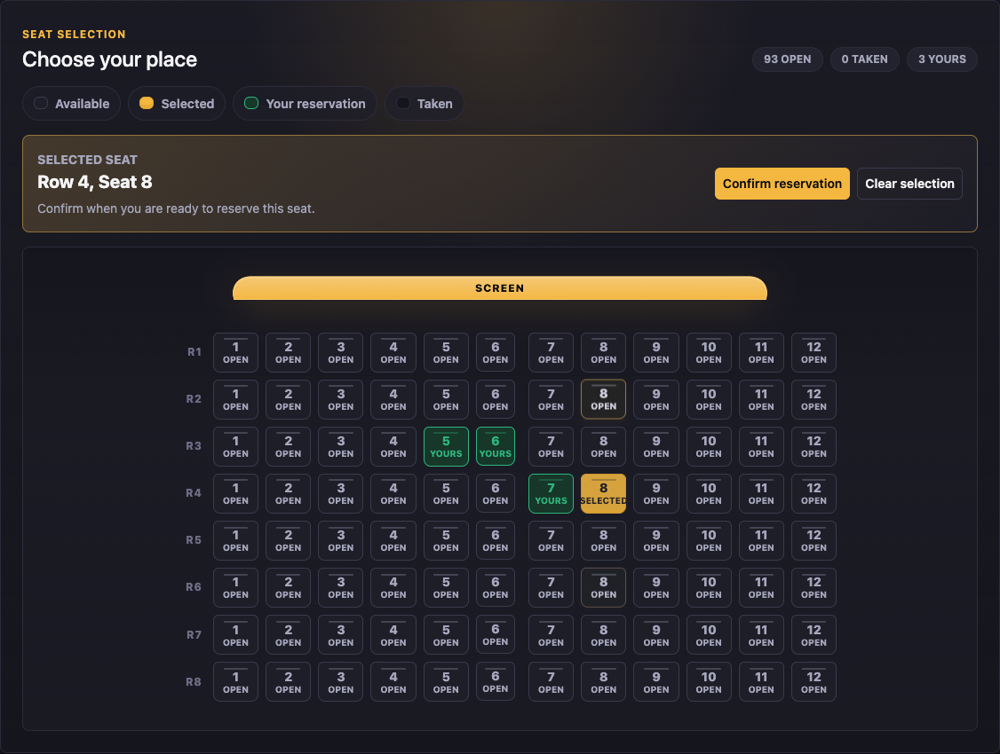

# Cinema Ticket Reservation System

Reserve specific cinema seats in a React interface backed by an ASP.NET Core API and SQLite. Users browse screenings, confirm or cancel seats, and edit profiles; admins manage screenings and accounts.

University course project, extended with a React seat map and API concurrency handling. Built with AI assistance.



Local demo with a fictional screening and sample accounts.

## Reservations under contention

Seat availability is a snapshot. The unique `(ScreeningId, RowNumber, SeatNumber)` index settles competing writes; the [reservation API](Controllers/Api/ScreeningsApiController.cs) returns 409 and the [seat map](ClientApp/src/components/SeatMap.jsx) refreshes after a conflict.

Both the API and the Razor pages reserve through [one service](Services/ReservationService.cs). It refuses seats for a screening that has already started, limits each account to `Reservations:MaxSeatsPerUserPerScreening` seats per screening (default 6), and returns the existing reservation when a user retries a seat they already hold. The limit check and the insert run in one SQLite `BEGIN IMMEDIATE` transaction, so two concurrent requests from one user cannot both pass the check.

Login, registration and seat reservation use ASP.NET Core's [rate limiter](Services/RateLimiting.cs). Login (`POST /api/auth/login` and the Identity login form) allows `RateLimiting:Login` attempts per client IP (default 10 per 60 s). Registration (`POST /api/auth/register` and the Identity register form) allows `RateLimiting:Register` per client IP (default 5 per 600 s). Both count POSTs only, and each has its own budget. Reservation allows `RateLimiting:Reservations` requests per signed-in user (default 30 per 60 s), and the API and the Razor form share that count. A request over the limit gets `429` with a `Retry-After` header.

The client IP comes from `X-Forwarded-For` only when the request arrives from a trusted proxy. By default that's loopback only (a proxy on the same host). Behind any other reverse proxy, list it under `ForwardedHeaders:KnownProxies` (IP addresses) or `ForwardedHeaders:KnownNetworks` (CIDR, e.g. `10.0.0.0/8`). Otherwise every client shares the proxy's address. Only the right-most forwarded entry is used, so a client can't choose its own partition by sending the header.

User edits carry an application-managed `RowVersion`. The [database context](Data/ApplicationDbContext.cs) replaces it on inserts and updates, and stale profile or admin requests receive the current values with a 409 response. [Integration tests](tests/MVC.Tests/Api/ReservationTests.cs) use SQLite to exercise its constraints.

## Run locally

Requires the .NET 8 SDK and Node.js 22.12+:

```bash
git clone https://github.com/yy31104/cinema-ticket-reservation-system.git
cd cinema-ticket-reservation-system
dotnet restore CinemaTicketReservation.sln
dotnet tool restore
dotnet ef database update --project MVC.csproj
npm --prefix ClientApp ci
npm --prefix ClientApp run build
dotnet run --project MVC.csproj --launch-profile http
```

Open [localhost:5101/screenings](http://localhost:5101/screenings). A new database has three cinemas and an empty screening list. Register at `/register`; the first account becomes admin when no admin exists. Create a screening at `/admin/screenings/create`, then return to the list and choose seats.

In another terminal, build and run the backend checks; tests take a few seconds after restore:

```bash
dotnet build CinemaTicketReservation.sln
dotnet test CinemaTicketReservation.sln
```

ASP.NET Core serves the React build and API from one process alongside the original MVC/Razor routes. Screening times are local wall-clock values, so venues in different timezones need an explicit timezone model.

The flow ends at reservation confirmation. Admin access also includes two legacy sample email addresses; review [AdminRoleService.cs](Services/AdminRoleService.cs) before sharing an instance.

See [architecture and concurrency](docs/ARCHITECTURE.md) and [seat states and keyboard controls](docs/DESIGN_SYSTEM.md) for implementation details.
